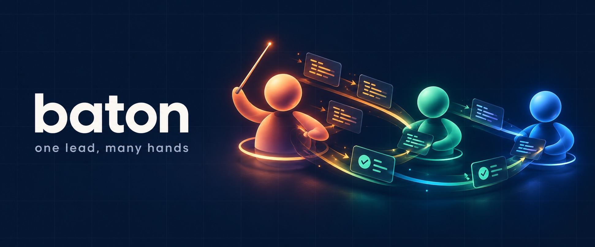
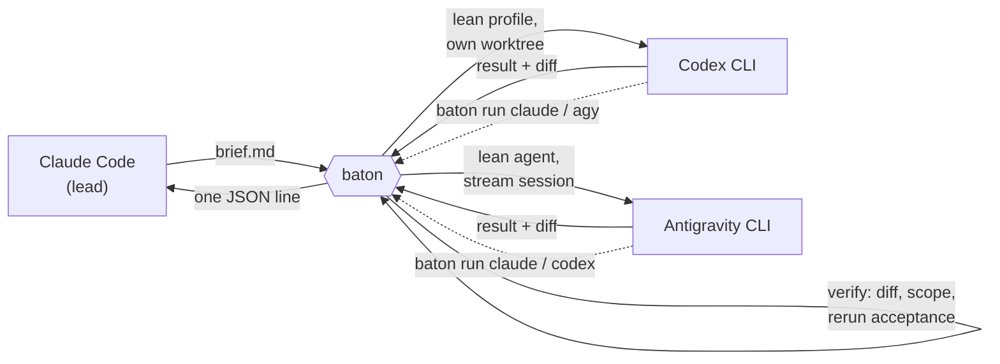

<p align="center"></p>

**baton** lets Claude Code lead while OpenAI's **Codex CLI** and Google's **Antigravity CLI**
(`agy`) do the bounded work. The lead writes a short brief; a worker implements it in its own git
worktree; baton checks the claim itself (diff present, files in scope, acceptance commands rerun)
and hands back one small JSON result. The lead spends its tokens on decisions and review, not on
typing code, and every subscription you pay for gets used.

One Rust binary, three hosts: the same plugin installs into Claude Code, Codex and Antigravity,
so any of the three can hand work to the others.

## What it looks like

In Claude Code, a delegated task is a row in the agent panel, updated live:

```
● baton:codex  Parser error recovery     codex · medium · 4 files · tests 38/38 · 92k tok · 5h 9%
● baton:agy    Docs for the CLI flags    agy · flash-low · 2 files · 31k tok · wk 47% left
```

When it ends, the lead reads a result like this and nothing else:

```json
{"task":"t-20261019-143210-9f2c","agent":"codex","status":"done","verified":true,
 "files_changed":["src/parser.rs","tests/parser_errors.rs"],"diffstat":"+212 -31 in 2 files",
 "out_of_scope":[],"acceptance":[{"command":"cargo test -q","passed":true,"tail":"38 passed"}],
 "rounds":1,"tokens":{"input":190369,"cached":156288,"output":5927},"seconds":312}
```

## Why it saves tokens

Every number below was measured on a real machine (details in
[`baton-reference`](plugins/baton/skills/baton-reference/)):

| | Default start | baton's lean start |
|---|---|---|
| Codex fixed prompt per call, uncached part (user config with 37 plugins) | 14,292 tokens | **2,459** |
| Antigravity fixed prompt per call (default agent vs a lean worker agent) | 11,906 tokens | **572** |
| Lead's cost per delegated task | the whole implementation | a brief (~400) + one result (~300) + the diff it chooses to read |

Fix rounds stay cheap too: Codex resumes the same thread with its prompt cache warm, and agy keeps
one stream session open per task, because a resumed agy conversation reloads everything uncached.
When acceptance fails, baton sends the failures back to the worker itself before the lead ever
looks (`--auto-fix`).

## How it works



- **Route by difficulty and quota.** `baton route` scores each worker, model and effort by how
  likely it is to finish this kind of task first time (learned from your own ledger), the tokens
  it usually takes, and how fast you are burning each subscription's 5-hour and weekly windows.
- **Quota for all three, free.** `baton usage` reads Codex limits from its app-server, agy's from
  `/usage`, and Claude's from the status line's store; none of these spends a token.
- **Guard rails.** Briefs that touch secrets or trading are refused for workers. Workers get a
  scrubbed environment. agy workers have no shell at all: baton runs the tests.

## Install

```sh
claude plugin marketplace add shiran-yu/baton
claude plugin install baton@baton            # also installs OpenAI's codex plugin
```

Then ask Claude Code to "set up baton" (the `setup` skill), or run `baton setup` yourself. It
builds or downloads the binary, installs the [Codex CLI](https://developers.openai.com/codex/cli)
and the [Antigravity CLI](https://antigravity.google/docs/cli/) if they are missing and tells you the one login command for each, grants agy
read and write on baton's worktree directory only, mirrors your plugins into both, and checks
everything with one tiny call each. Every install and config change asks first.
It is also part of [my-develop-plugins](https://github.com/shiran-yu/my-develop-plugins).

## Use

Ask Claude Code to delegate ("have Codex implement this with tests", "get agy to write the docs"),
or drive it yourself:

```sh
baton usage                                   # remaining quota of claude, codex, agy
baton route --brief .baton/parser.md          # who should do it, with which model and effort
baton run codex --brief .baton/parser.md      # run, verify, print the result
baton show <task> --diff                      # read the diff
baton fix <task> --notes .baton/fixes.md      # send fixes back to the same worker
baton accept <task>                           # merge the task branch
baton scorecard                               # first-pass success and tokens, per worker and task type
```

A brief is Markdown with `## Goal`, `## Files`, `## Forbidden` and `## Acceptance` (a code block
of commands that must pass). See the [lead's playbook](plugins/baton/skills/baton/SKILL.md).

## Status

0.1, built by baton itself: after the first core, every part was briefed by Claude Code,
implemented by Codex in its own worktree, verified by baton and reviewed before merging.

| Part | State |
|---|---|
| Codex and Antigravity drivers, worktrees, verification, auto-fix, detach and wait | done |
| Quota for all three (`baton usage`), status-line and agent-panel rows | done |
| Routing by difficulty and quota, ledger and scorecard | done; priors still being tuned from the ledger |
| `baton sync` (Claude Code plugins into Codex and agy, with hook conversion) | done; trading plugins stay out of agy until their guards are proven there |
| `baton setup` and release binaries for macOS and Linux (x86_64, arm64) | done; first tagged release pending |
| Live token counts for Codex while it works | in progress |

Design: [DESIGN.md](DESIGN.md).

## Licence

CC BY-NC-SA 4.0. OpenAI's codex plugin, installed as a dependency, is Apache-2.0. Codex, Claude
Code and Antigravity are products of their respective companies; baton is an independent tool
and is not affiliated with any of them.
